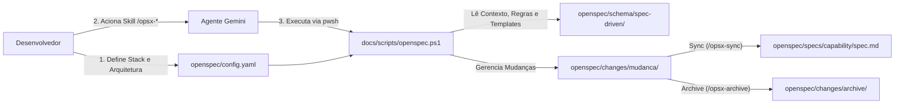

# OpenSpec PowerShell 7 (`openspec-powershell-7`)

> **Resumo Executivo**: Fork e adaptação do projeto original [Fission-AI/OpenSpec](https://github.com/Fission-AI/OpenSpec.git) reescrito para operar **100% via PowerShell 7 (`pwsh`)** no **Windows** e no **macOS**, totalmente **agnóstico a linguagem de programação e arquitetura de software**, sem dependência de Node.js, `npm` ou `pnpm`, e pré-configurado para uso imediato no **Gemini**.

---

## 🎯 1. O Que Você Vai Aprender & Construir

Ao concluir a leitura e o guia prático deste documento, você será capaz de:
- [ ] **Compreender** a arquitetura e a stack deste fork em PowerShell 7 em comparação ao CLI original.
- [ ] **Identificar** a responsabilidade de cada diretório e arquivo do repositório e do pacote de distribuição [`dist/`](./dist).
- [ ] **Importar e Configurar** os arquivos do diretório [`dist/`](./dist) em qualquer projeto (independentemente da linguagem ou arquitetura que você utilize) no Windows ou macOS.
- [ ] **Definir** a linguagem, arquitetura e regras do seu projeto em [`openspec/config.yaml`](./dist/openspec/config.yaml) para que o Gemini as utilize automaticamente.
- [ ] **Executar e Validar** o ciclo completo de especificações (`context`, `new`, `status`, `instructions`, `validate`, `tasks` e `archive`) integrado ao **Gemini**.

### 🖼️ Resultado Final Esperado

Ao final do passo a passo de importação do diretório [`dist/`](./dist), seu novo projeto responderá aos comandos nativos do OpenSpec via `pwsh` com saída JSON estruturada pronta para consumo pelo Gemini:

```json
{
  "root": {
    "path": "/caminho/do/seu-novo-projeto",
    "openspecDir": "/caminho/do/seu-novo-projeto/openspec",
    "configPath": "/caminho/do/seu-novo-projeto/openspec/config.yaml"
  },
  "schema": "spec-driven",
  "hasContext": true,
  "contextLength": 248,
  "rulesKeys": [
    "design",
    "proposal",
    "specs",
    "tasks"
  ]
}
```

---

## 🛠️ 2. Stack do Projeto & Pré-Requisitos

### Stack Tecnológica do OpenSpec PowerShell 7

| Camada / Componente | Tecnologia / Padrão | Propósito no Projeto |
| :--- | :--- | :--- |
| **Runtime & CLI Core** | **PowerShell 7.0+** (`pwsh` / `#Requires -Version 7.0`) | Motor multiplataforma (Windows e macOS) que gerencia todo o ciclo OpenSpec pelo script local [`openspec.ps1`](./dist/docs/scripts/openspec.ps1). |
| **Integração de IA (Agente)** | **Google Gemini** ([`.agents/skills/`](./dist/.agents/skills) + [`GEMINI.md`](./GEMINI.md)) | Conjunto de 6 skills OpenSpec (`mode: "pwsh7-no-cli"`) configuradas para guiar o Gemini no ciclo *spec-driven* respeitando a linguagem e arquitetura definidas pelo usuário. |
| **Configuração Agnóstica** | **YAML & Markdown** ([`config.yaml`](./dist/openspec/config.yaml) + [`schema.yaml`](./dist/openspec/schema/spec-driven/schema.yaml)) | Permite ao usuário declarar qualquer linguagem de programação, arquitetura, camadas e comandos de build/teste do seu projeto sem acoplamento prévio. |
| **Contrato de Dados** | **JSON (UTF-8)** | Comunicação estruturada entre a CLI `openspec.ps1` e o agente Gemini (`--json`). |
| **Testes & Auditoria** | **PowerShell Sandbox Test Runner** | Suíte de testes ponta a ponta sem dependências externas ([`openspec.Tests.ps1`](./dist/docs/scripts/tests/openspec.Tests.ps1)) e auditor de conformidade ([`buscar-openspec.ps1`](./dist/docs/scripts/buscar-openspec.ps1)). |
| **Sistemas Operacionais** | **Windows 10/11** e **macOS** | Suporte multiplataforma nativo via `pwsh` com resolução segura de caminhos (`Join-Path` e proteção contra *path traversal*). |

### Conhecimentos Prévios Necessários
- Familiaridade básica com comandos de terminal no PowerShell 7 (`pwsh`).
- Noções de fluxo de desenvolvimento orientado a especificações (*Spec-Driven Development*) com assistentes de IA (Gemini).

### Ferramentas e Versões Homologadas
- **PowerShell 7**: versão `7.0` ou superior instalada e acessível no `PATH` através do comando `pwsh`.
- **Git**: versão `2.30+` para controle de versão e commits por etapa.
- **Agente Gemini**: ambiente compatível com leitura de [`GEMINI.md`](./GEMINI.md) e catálogo [`.agents/skills/`](./dist/.agents/skills).

### Tempo Estimado de Conclusão
⏱️ **15 minutos** para importação, definição da arquitetura do seu projeto e validação completa.

---

## 🧱 3. Conceito Fundamental & Estrutura de Diretórios

> [!NOTE]
> **Como funcionava antes vs. Como funciona agora**:
> No projeto original [Fission-AI/OpenSpec](https://github.com/Fission-AI/OpenSpec.git), o gerenciamento das mudanças dependia de pacotes Node.js e da CLI global `openspec`. Neste fork, toda a orquestração do schema `spec-driven` foi consolidada no script autossuficiente [`docs/scripts/openspec.ps1`](./dist/docs/scripts/openspec.ps1), executado diretamente pelo `pwsh` e acionado pelas skills do Gemini em [`.agents/skills/`](./dist/.agents/skills).
>
> Além disso, todos os templates, instruções e skills em [`dist/`](./dist) são **100% agnósticos a linguagem e arquitetura**: o agente Gemini lê o que **você** definiu em `openspec/config.yaml` e aplica as convenções da sua stack em todas as etapas (`proposal`, `specs`, `design`, `tasks`, `apply` e `archive`).

### Diagrama de Fluxo de Trabalho (Gemini + PowerShell 7)



### Estrutura de Diretórios do Repositório

```text
openspec-powershell-7/
├── GEMINI.md                                  # Regras mandatórias de governança e execução para o agente Gemini
├── LICENSE                                    # Licença MIT do projeto
├── README.md                                  # Documentação principal e tutorial de utilização
│
├── dist/                                      # 📦 PACOTE DE DISTRIBUIÇÃO (arquivos prontos para importar em novos projetos)
│   ├── .agents/
│   │   ├── skills.json                        # Manifesto das 6 skills OpenSpec pré-configuradas para o Gemini
│   │   └── skills/
│   │       ├── openspec-explore/SKILL.md      # Skill: modo de exploração e investigação (/opsx-explore)
│   │       ├── openspec-propose/SKILL.md      # Skill: criação de mudança e artefatos de planejamento (/opsx-propose)
│   │       ├── openspec-apply-change/SKILL.md # Skill: implementação assistida etapa por etapa (/opsx-apply)
│   │       ├── openspec-update-change/SKILL.md# Skill: revisão e alinhamento de artefatos (/opsx-update)
│   │       ├── openspec-sync-specs/SKILL.md   # Skill: merge inteligente de delta specs (/opsx-sync)
│   │       └── openspec-archive-change/SKILL.md # Skill: validação final e arquivamento (/opsx-archive)
│   │
│   ├── docs/
│   │   └── scripts/
│   │       ├── openspec.ps1                   # CLI principal OpenSpec em PowerShell 7
│   │       ├── buscar-openspec.ps1            # Script auditor para validar ausência de referências legadas
│   │       └── tests/
│   │           └── openspec.Tests.ps1         # Suíte de testes automatizados em sandbox isolada
│   │
│   └── openspec/
│       ├── config.yaml                        # Configuração onde o usuário define linguagem, arquitetura e regras do projeto
│       ├── changes/
│       │   └── archive/                       # Histórico de mudanças concluídas e arquivadas (YYYY-MM-DD-<nome>)
│       ├── specs/                             # Especificações principais canônicas do projeto (<capability>/spec.md)
│       └── schema/
│           └── spec-driven/
│               ├── schema.yaml                # Definição do grafo de artefatos (proposal -> specs -> design -> tasks)
│               ├── change-meta.yaml           # Template de metadados (.openspec.yaml) de cada mudança
│               ├── instructions/              # Instruções agnósticas por fase (proposal, specs, design, tasks, apply, archive)
│               └── templates/                 # Modelos Markdown agnósticos (proposal, spec-delta, spec-main, design, tasks)
│
├── .agents/                                   # Skills ativas neste próprio repositório (OpenSpec + Product Manager + Tutorial Engineer)
├── docs/scripts/                              # Scripts ativos neste próprio repositório
└── openspec/                                  # Estrutura OpenSpec ativa neste próprio repositório
```

---

## 🚀 4. Passo a Passo Hands-On: Utilizando o Diretório `dist` em um Novo Projeto

Todos os arquivos necessários para habilitar o OpenSpec com PowerShell 7 e Gemini em qualquer projeto novo ou existente já estão empacotados dentro de [`dist/`](./dist). Siga as etapas abaixo no **Windows** ou no **macOS**.

---

### Passo 1: Verificar a Instalação do PowerShell 7 (`pwsh`)

Antes de copiar os arquivos, certifique-se de que o runtime do PowerShell 7 está ativo no seu terminal.

1. Abra o seu terminal no **Windows** ou **macOS** e execute:
   ```powershell
   pwsh -NoProfile -Command '$PSVersionTable.PSVersion'
   ```

🔍 **Ponto de Verificação (Checkpoint)**:
A saída deve exibir `Major` igual ou superior a `7`:
```text
Major  Minor  Patch  PreReleaseLabel BuildLabel
-----  -----  -----  --------------- ----------
7      4      6
```

> [!TIP]
> **Instalação rápida caso não possua o `pwsh`**:
> - **Windows**: `winget install --id Microsoft.PowerShell --source winget`
> - **macOS**: `brew install --cask powershell`

---

### Passo 2: Importar os Arquivos do Diretório `dist` para o Novo Projeto

Neste passo, copiaremos as três pastas estruturais de [`dist/`](./dist) (`.agents`, `docs` e `openspec`) e o arquivo [`GEMINI.md`](./GEMINI.md) para a raiz do seu projeto de destino.

1. No terminal (`pwsh`), defina o caminho do repositório `openspec-powershell-7` e o caminho do seu projeto de destino, e copie os arquivos:

   **No Windows (PowerShell 7):**
   ```powershell
   $OrigemRepo = "C:\caminho\para\openspec-powershell-7"
   $DestinoProjeto = "C:\caminho\para\meu-novo-projeto"

   New-Item -ItemType Directory -Path $DestinoProjeto -Force | Out-Null
   Copy-Item -Path (Join-Path $OrigemRepo "dist\*") -Destination $DestinoProjeto -Recurse -Force
   Copy-Item -Path (Join-Path $OrigemRepo "GEMINI.md") -Destination (Join-Path $DestinoProjeto "GEMINI.md") -Force
   ```

   **No macOS (PowerShell 7):**
   ```powershell
   $OrigemRepo = "$HOME/caminho/para/openspec-powershell-7"
   $DestinoProjeto = "$HOME/caminho/para/meu-novo-projeto"

   New-Item -ItemType Directory -Path $DestinoProjeto -Force | Out-Null
   Copy-Item -Path (Join-Path $OrigemRepo "dist/*") -Destination $DestinoProjeto -Recurse -Force
   Copy-Item -Path (Join-Path $OrigemRepo "GEMINI.md") -Destination (Join-Path $DestinoProjeto "GEMINI.md") -Force
   ```

🔍 **Ponto de Verificação (Checkpoint)**:
Acesse o diretório do seu projeto e verifique se a estrutura foi importada:
```powershell
Set-Location $DestinoProjeto
pwsh -NoProfile -ExecutionPolicy Bypass -File "docs/scripts/buscar-openspec.ps1"
```
Saída esperada (confirma que as 6 skills foram localizadas e estão prontas para o PowerShell 7):
```text
arquivos=6 ocorrencias=0
```

---

### Passo 3: Definir a Linguagem e a Arquitetura do Seu Projeto em `openspec/config.yaml`

O arquivo [`openspec/config.yaml`](./dist/openspec/config.yaml) (já copiado automaticamente de `dist/openspec/config.yaml`) é o ponto central onde você define a linguagem de programação, a arquitetura, as camadas e os comandos de build e teste do seu projeto. O script [`docs/scripts/openspec.ps1`](./dist/docs/scripts/openspec.ps1) injeta essas definições em todas as instruções fornecidas ao Gemini.

1. Edite o arquivo `openspec/config.yaml` na raiz do seu projeto para refletir exatamente o que você definiu para o seu sistema:
   ```yaml
   schema: spec-driven

   context: |
     Descreva aqui a linguagem de programação, runtime, arquitetura (camadas, módulos,
     padrões de projeto), banco de dados, ferramentas de build/teste e restrições
     técnicas definidas para o seu projeto.

   rules:
     proposal:
       - Definir claramente o problema, o escopo positivo e o que está fora de escopo.
       - Respeitar a arquitetura e os módulos definidos pelo usuário no projeto.
       - Listar todas as capabilities impactadas em openspec/specs/.
     specs:
       - Utilizar linguagem normativa (SHALL ou MUST) em todos os requisitos.
       - Incluir ao menos um cenário GIVEN / WHEN / THEN por requisito.
     design:
       - Respeitar estritamente a linguagem, stack e arquitetura definidas pelo usuário.
       - Documentar decisões técnicas, contratos, modelo de dados e estratégia de testes.
     tasks:
       - Organizar a implementação em etapas sequenciais e verificáveis (uma etapa por vez).
       - Incluir validação de build, análise estática e testes automatizados da stack do projeto.
   ```

🔍 **Ponto de Verificação (Checkpoint)**:
Teste o comando `context` da CLI para confirmar que o seu `config.yaml` foi carregado:
```powershell
pwsh -NoProfile -ExecutionPolicy Bypass -File "docs/scripts/openspec.ps1" context --json
```
Saída esperada:
```json
{
  "root": {
    "path": ".../meu-novo-projeto",
    "openspecDir": ".../meu-novo-projeto/openspec",
    "configPath": ".../meu-novo-projeto/openspec/config.yaml"
  },
  "schema": "spec-driven",
  "hasContext": true,
  "contextLength": 248,
  "rulesKeys": [
    "design",
    "proposal",
    "specs",
    "tasks"
  ]
}
```

---

### Passo 4: Validar a Integridade do Motor OpenSpec com a Suíte de Testes

Para confirmar que todos os subcomandos do OpenSpec e o schema `spec-driven` estão funcionando perfeitamente no seu sistema operacional (Windows ou macOS):

1. Execute a suíte de testes automatizados incluída em [`docs/scripts/tests/openspec.Tests.ps1`](./dist/docs/scripts/tests/openspec.Tests.ps1) (que roda em uma sandbox temporária isolada e limpa automaticamente ao finalizar):
   ```powershell
   pwsh -NoProfile -ExecutionPolicy Bypass -File "docs/scripts/tests/openspec.Tests.ps1"
   ```

🔍 **Ponto de Verificação (Checkpoint)**:
Confirme que todos os 18 testes passaram com `0` falhas:
```text
PASS: context retorna schema spec-driven e hasContext=true
PASS: new test-change cria pasta e .openspec.yaml
PASS: new rejeita nome fora do padrão kebab-case
PASS: new rejeita mudança duplicada
PASS: status inicial: proposal=ready e specs=blocked
PASS: status após proposal+specs: design=ready e tasks=ready (design opcional)
PASS: instructions proposal retorna template e rules
PASS: instructions apply retorna blocked antes de tasks.md
PASS: tasks ignora code fence e retorna linha exata (8)
PASS: instructions apply retorna ready com 1 tarefa pendente
PASS: validate --change aprova delta válido
PASS: validate --change rejeita delta sem SHALL/MUST e sem Scenario
PASS: validate --specs aprova spec principal canônica
PASS: validate --specs rejeita spec principal contendo cabeçalho de delta
PASS: archive bloqueia mudança com tarefa aberta sem --force
PASS: instructions apply retorna all_done com 2/2 tarefas concluídas
PASS: archive move pasta com data e preserva .openspec.yaml
PASS: archive não duplica prefixo YYYY-MM-DD- existente

Resumo: 18 passaram, 0 falharam.
```

---

### Passo 5: Executar o Fluxo Completo com o Gemini e a CLI `openspec.ps1`

Os arquivos importados de [`dist/.agents/`](./dist/.agents) já estão prontos para o **Gemini**. Ao abrir o projeto no seu ambiente com suporte ao Gemini, você pode acionar tanto as skills conversacionais quanto os comandos diretos via terminal.

#### 5.1. Comandos / Skills Disponíveis no Gemini

| Skill (`.agents/skills/`) | Gatilhos no Chat do Gemini | O Que Faz |
| :--- | :--- | :--- |
| **[`openspec-explore`](./dist/.agents/skills/openspec-explore/SKILL.md)** | `openspec explore` ou `opsx explore` | Investiga o código na arquitetura do usuário, desenha fluxos ASCII e amadurece requisitos sem alterar código de produção. |
| **[`openspec-propose`](./dist/.agents/skills/openspec-propose/SKILL.md)** | `openspec propose` ou `opsx propose` | Cria a pasta da mudança (`new`) e gera `proposal.md`, delta `specs/`, `design.md` (opcional) e `tasks.md` seguindo o `config.yaml`. |
| **[`openspec-apply-change`](./dist/.agents/skills/openspec-apply-change/SKILL.md)** | `openspec apply` ou `opsx apply` | Implementa as tarefas de `tasks.md` **uma etapa por vez** na linguagem do projeto, com validação, commit local e pausa entre etapas. |
| **[`openspec-update-change`](./dist/.agents/skills/openspec-update-change/SKILL.md)** | `openspec update change` ou `opsx update` | Revisa e sincroniza alterações de escopo ou design entre os artefatos de planejamento existentes. |
| **[`openspec-sync-specs`](./dist/.agents/skills/openspec-sync-specs/SKILL.md)** | `openspec sync` ou `opsx sync` | Realiza o merge inteligente dos delta specs da mudança para as especificações canônicas em `openspec/specs/`. |
| **[`openspec-archive-change`](./dist/.agents/skills/openspec-archive-change/SKILL.md)** | `openspec archive` ou `opsx archive` | Verifica artefatos, tarefas e sync de specs, movendo a mudança concluída para `openspec/changes/archive/YYYY-MM-DD-<nome>`. |

#### 5.2. Referência Rápida de Subcomandos da CLI (`docs/scripts/openspec.ps1`)

Você (ou o agente Gemini) pode operar todo o ciclo diretamente pelo terminal com os seguintes comandos:

```powershell
# 1. Consultar contexto e raiz do OpenSpec
pwsh -NoProfile -ExecutionPolicy Bypass -File "docs/scripts/openspec.ps1" context --json

# 2. Criar uma nova mudança (sempre em kebab-case)
pwsh -NoProfile -ExecutionPolicy Bypass -File "docs/scripts/openspec.ps1" new "add-autenticacao-oauth"

# 3. Consultar o status e dependências dos artefatos da mudança
pwsh -NoProfile -ExecutionPolicy Bypass -File "docs/scripts/openspec.ps1" status --change "add-autenticacao-oauth" --json

# 4. Obter template, regras e instruções de um artefato (proposal | specs | design | tasks | apply | archive)
pwsh -NoProfile -ExecutionPolicy Bypass -File "docs/scripts/openspec.ps1" instructions proposal --change "add-autenticacao-oauth" --json

# 5. Validar os delta specs de uma mudança ou todas as specs principais
pwsh -NoProfile -ExecutionPolicy Bypass -File "docs/scripts/openspec.ps1" validate --change "add-autenticacao-oauth" --json
pwsh -NoProfile -ExecutionPolicy Bypass -File "docs/scripts/openspec.ps1" validate --specs --json

# 6. Listar o progresso das tarefas de tasks.md
pwsh -NoProfile -ExecutionPolicy Bypass -File "docs/scripts/openspec.ps1" tasks --change "add-autenticacao-oauth" --json

# 7. Arquivar uma mudança concluída
pwsh -NoProfile -ExecutionPolicy Bypass -File "docs/scripts/openspec.ps1" archive --change "add-autenticacao-oauth"
```

---

## 🛠️ 5. Resolução de Problemas Comuns (Troubleshooting)

| Sintoma / Mensagem de Erro | Possível Causa | Solução Recomendada |
| :--- | :--- | :--- |
| `O arquivo ... não pode ser carregado porque a execução de scripts foi desabilitada neste sistema` | O comando foi invocado no Windows PowerShell 5.1 (`powershell.exe`) ou sem as flags de bypass de política de execução. | Utilize sempre o executável do PowerShell 7 (`pwsh`) com os parâmetros: `pwsh -NoProfile -ExecutionPolicy Bypass -File "docs/scripts/openspec.ps1" ...` |
| `{"error": "no_openspec_root", "code": "no_openspec_root", ...}` | O terminal está sendo executado fora da árvore do projeto ou a pasta `openspec/` não foi copiada de `dist/`. | Navegue até a raiz do projeto (`Set-Location /caminho/do/projeto`) onde a pasta `openspec/` reside, ou passe `--root "/caminho/do/projeto"`. |
| `{"error": "invalid_name", "message": "Nome inválido ... Use kebab-case"}` | O nome da mudança contém letras maiúsculas, underscores (`_`), espaços ou utiliza a palavra reservada `archive`. | Nomeie a mudança exclusivamente em `kebab-case` minúsculo (ex.: `add-user-auth`, `fix-calculo-imposto`). |
| `validate --change` falha com `deve conter linguagem normativa (SHALL ou MUST)` ou `deve possuir ao menos um '#### Scenario:'` | O arquivo de delta spec (`specs/<cap>/spec.md`) foi redigido sem as palavras-chave normativas em maiúsculas ou sem bloco de cenário. | Em cada `### Requirement: <Nome>`, inclua `SHALL` ou `MUST` no texto descritivo e adicione ao menos um bloco `#### Scenario: <Nome>` com `- **GIVEN**`, `- **WHEN**`, `- **THEN**`. |
| `{"error": "incomplete_change", ...}` ao executar `archive` | Existem artefatos obrigatórios não concluídos ou checkboxes `- [ ]` em aberto no arquivo `tasks.md`. | Conclua e marque `- [x]` nas tarefas finalizadas em `tasks.md` (ou utilize `--force` somente quando o arquivamento parcial for intencional). |

---

## 🧠 6. Exercícios de Fixação & Desafios Práticos

Para consolidar o domínio sobre o fluxo OpenSpec com PowerShell 7, pratique com os desafios progressivos abaixo no seu projeto recém-configurado:

1. **Desafio 1 (Nível Básico — Ciclo de Criação e Status)**:
   - Crie uma mudança chamada `add-healthcheck-endpoint` utilizando `openspec.ps1 new`, consulte o status inicial e identifique quais artefatos nascem com `status: "ready"` e quais nascem com `status: "blocked"`.
2. **Desafio 2 (Nível Intermediário — Depuração de Delta Spec / Fail Forward)**:
   - Crie deliberadamente um arquivo `openspec/changes/add-healthcheck-endpoint/specs/health/spec.md` **sem** a palavra `SHALL`/`MUST`, execute `validate --change "add-healthcheck-endpoint" --json`, analise o array `errors` retornado pelo validador e corrija o arquivo até obter `"valid": true`.
3. **Desafio 3 (Nível Avançado — Mudança sem Delta Specs com `--skip-specs`)**:
   - Crie uma mudança puramente de refatoração interna ou documentação chamada `refactor-build-scripts` passando a flag `--skip-specs`, gere `proposal.md` e `tasks.md`, marque todas as tarefas como `- [x]` e arquive a mudança com `archive --change "refactor-build-scripts"`.

<details>
<summary>💡 Dica / Solução Sugerida para os Desafios 1 e 2</summary>

```powershell
# Solução Desafio 1: Criar mudança e verificar status
pwsh -NoProfile -ExecutionPolicy Bypass -File "docs/scripts/openspec.ps1" new "add-healthcheck-endpoint"
pwsh -NoProfile -ExecutionPolicy Bypass -File "docs/scripts/openspec.ps1" status --change "add-healthcheck-endpoint" --json

# Solução Desafio 2: Criar proposal.md e delta spec válido e validar
Set-Content -LiteralPath "openspec/changes/add-healthcheck-endpoint/proposal.md" -Value "# Proposta: Healthcheck`n" -Encoding UTF8
New-Item -ItemType Directory -Path "openspec/changes/add-healthcheck-endpoint/specs/health" -Force | Out-Null

@'
# Spec Delta: health

## Purpose
Monitoramento de saúde do sistema.

## ADDED Requirements

### Requirement: Verificação de Saúde
The system SHALL responder com status de integridade válido quando consultado.

#### Scenario: Sistema operacional
- **GIVEN** o sistema inicializado
- **WHEN** uma verificação de saúde é solicitada
- **THEN** retorna confirmação de disponibilidade
'@ | Set-Content -LiteralPath "openspec/changes/add-healthcheck-endpoint/specs/health/spec.md" -Encoding UTF8

pwsh -NoProfile -ExecutionPolicy Bypass -File "docs/scripts/openspec.ps1" validate --change "add-healthcheck-endpoint" --json
```
</details>

---

## 🏁 7. Conclusão & Próximos Passos

### Recapitulação dos Conceitos Dominados
- **Independência de Runtime e Stack**: Toda a gestão do ciclo OpenSpec roda nativamente em PowerShell 7 (`pwsh`) no Windows e no macOS através de [`docs/scripts/openspec.ps1`](./dist/docs/scripts/openspec.ps1), adaptando-se a qualquer linguagem e arquitetura definida em [`openspec/config.yaml`](./dist/openspec/config.yaml).
- **Distribuição Limpa via `dist/`**: Basta copiar o conteúdo de [`dist/`](./dist) (`.agents/`, `docs/scripts/` e `openspec/`) para habilitar instantaneamente as 6 skills OpenSpec no Gemini.
- **Qualidade Garantida por Validação Formal**: O validador embutido assegura requisitos normativos (`SHALL`/`MUST`), cenários `GIVEN/WHEN/THEN` e integridade das especificações principais antes do arquivamento.

### Recursos Adicionais para Aprofundamento
- 📖 [Repositório Original Fission-AI/OpenSpec](https://github.com/Fission-AI/OpenSpec.git)
- 📜 [Regras de Governança do Agente (`GEMINI.md`)](./GEMINI.md)
- ⚙️ [Configuração Base do Projeto (`dist/openspec/config.yaml`)](./dist/openspec/config.yaml)
- 📐 [Definição do Schema Spec-Driven (`dist/openspec/schema/spec-driven/schema.yaml`)](./dist/openspec/schema/spec-driven/schema.yaml)
- 🧪 [Suíte de Testes Automatizados (`dist/docs/scripts/tests/openspec.Tests.ps1`)](./dist/docs/scripts/tests/openspec.Tests.ps1)
